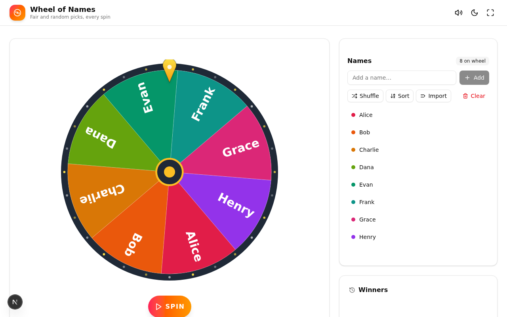
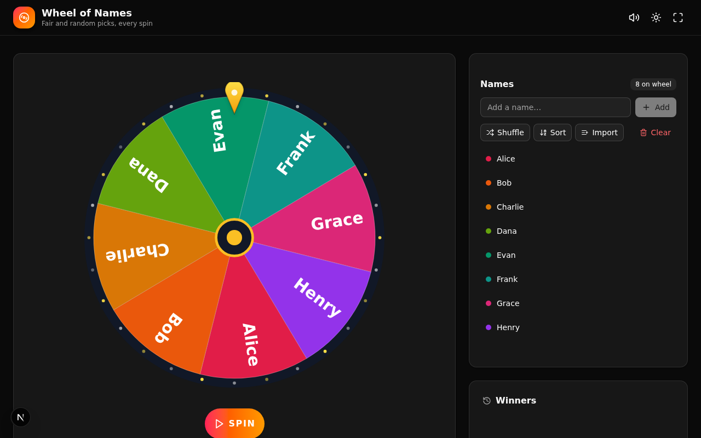
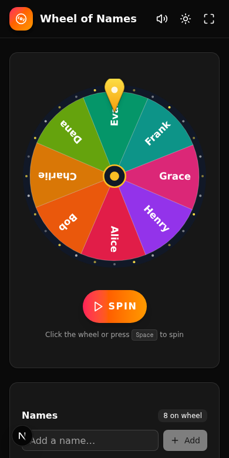

# 🎡 Wheel of Names

A colorful, carnival-style random name picker. Spin the wheel to pick a winner fairly — perfect for classrooms, raffles, team draws, and club meetings.



## Features

- **Big beautiful wheel** — HTML5 canvas with a carnival rim of twinkling bulbs, an 8-color palette, and a gold pointer
- **Realistic spins** — randomized turn counts and smooth ease-out deceleration (respects `prefers-reduced-motion`)
- **Sounds, synthesized** — a wooden *tick* as each segment passes the pointer, and a victory fanfare for the winner. No audio files, and mutable with one click
- **Name management** — add one at a time or paste a whole list (new lines, commas, or semicolons); duplicates are skipped automatically. Shuffle, sort A→Z, or clear everything
- **Winner celebration** — confetti cannons plus a big gradient banner for the chosen name
- **Remove winner & spin again** — ideal for drawing multiple people from one pool without repeats
- **Winners history** — the last 30 picks with timestamps
- **Dark mode** — light/dark toggle that follows your system preference by default
- **Fullscreen mode** — great for projecting in front of a room
- **Keyboard friendly** — press <kbd>Space</kbd> anywhere (outside a text box) to spin
- **Auto-saving** — names, history, and settings persist in `localStorage`; nothing leaves your device
- **Responsive** — two-column desktop layout, stacked mobile layout




## Getting started

Requires **Node.js 20+** (or [Bun](https://bun.sh) 1.1+).

```bash
# install dependencies
npm install     # or: bun install

# start the dev server
npm run dev     # or: bun run dev
```

Open [http://localhost:3000](http://localhost:3000) and start adding names.

To produce a production build:

```bash
npm run build
npm start
```

## How it works

The wheel is drawn on an `<canvas>` element with HiDPI scaling and re-renders every frame via `requestAnimationFrame`:

- **Segments** are computed from the name list; each gets a color from an 8-color palette and a radially-rotated, auto-truncated label
- **Spinning** animates the rotation with an ease-out curve over 4–6 seconds with 5–8 full turns (1 turn / 0.9 s when reduced motion is preferred)
- **The winner** is whichever segment lands under the top pointer when the animation finishes
- **Sounds** are generated with the Web Audio API (square-wave ticks and a triangle-wave fanfare), so there are no audio assets to load

Everything runs client-side — there is no backend and no tracking. Names live only in your browser's `localStorage`.

## Tech stack

- [Next.js 16](https://nextjs.org) (App Router) + TypeScript
- [Tailwind CSS 4](https://tailwindcss.com) + [shadcn/ui](https://ui.shadcn.com)
- [canvas-confetti](https://github.com/catdad/canvas-confetti)
- [next-themes](https://github.com/pacocoursey/next-themes)
- [lucide-react](https://lucide.dev) icons

## Project structure

```
src/
  app/
    page.tsx              # the whole app — wheel, panels, dialogs, persistence
    layout.tsx            # theme provider + toast host
  components/
    wheel/
      Wheel.tsx           # canvas wheel: drawing, spin physics, ticks
      NameManager.tsx     # add / import / shuffle / sort / remove names
      WinnerDialog.tsx    # winner modal + confetti
    ui/                   # shadcn/ui primitives
  lib/
    wheel-sounds.ts       # Web Audio tick + fanfare synthesizer
    utils.ts              # class name helper
```

## License

MIT — do whatever you'd like. Have fun spinning! 🎉
